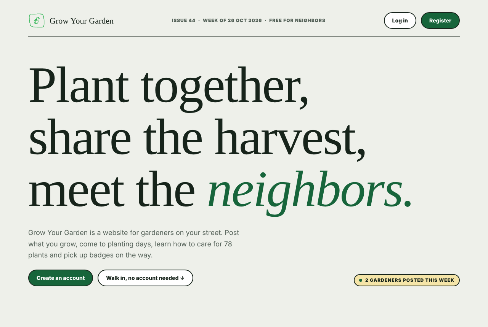
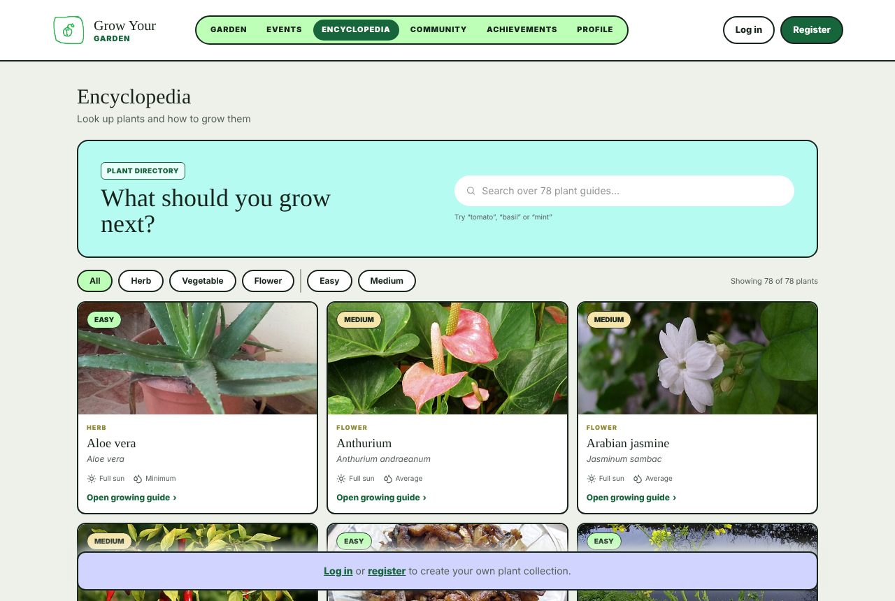
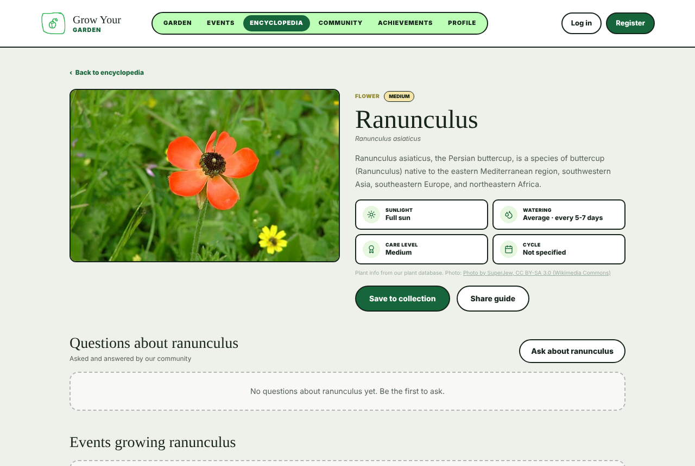
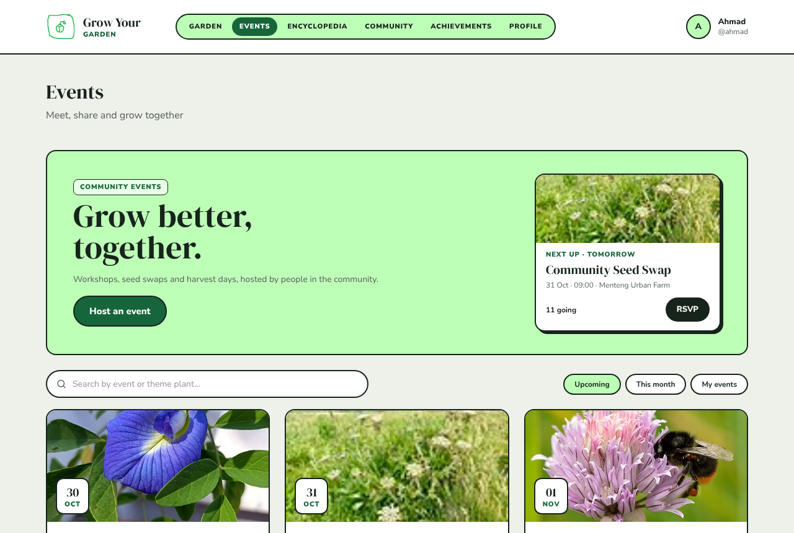
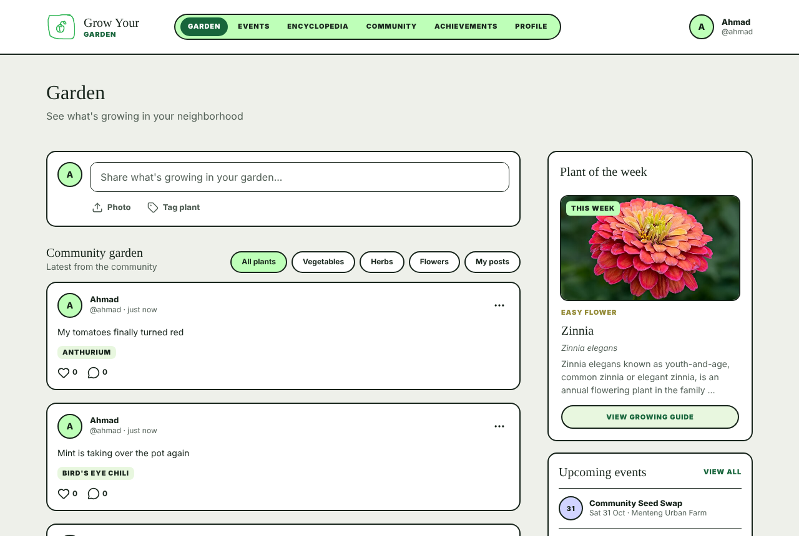
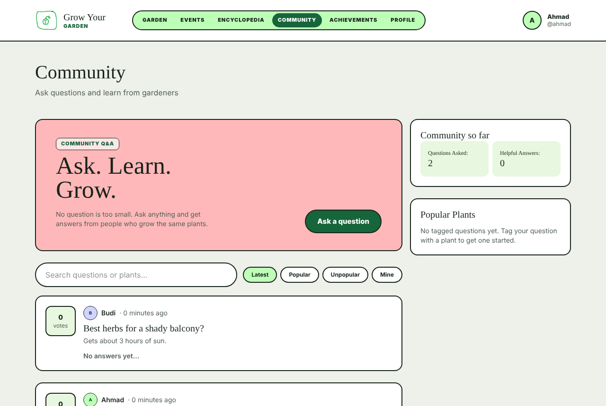
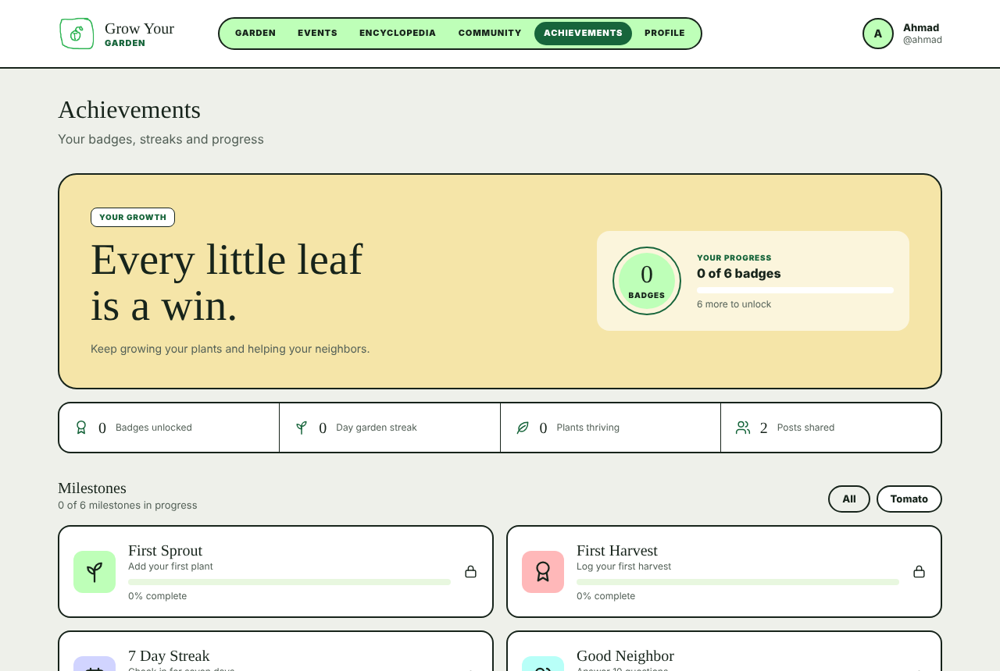
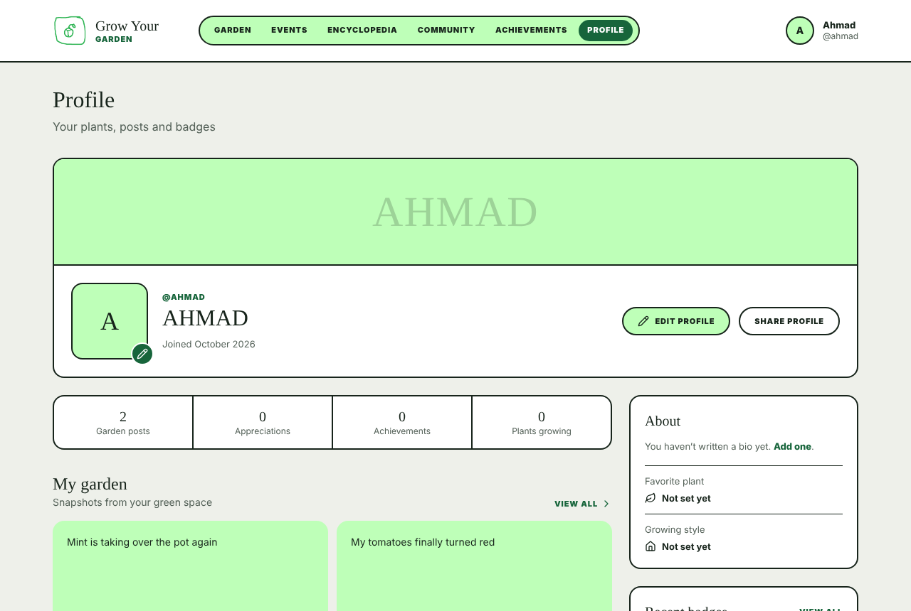
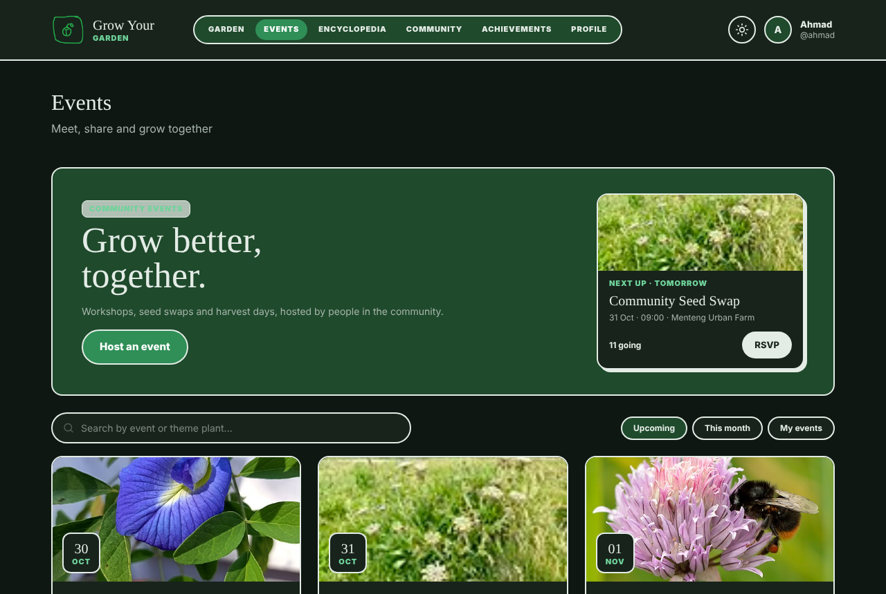

# GROW YOUR GARDEN 🌱🌷
**Theme:** Sustainable Living - Urban Farming & Biodiversity

## 1. Application Description
**GROW YOUR GARDEN** is an interactive urban gardening platform that combines educational gardening guides with a community-driven social media space. The application helps users learn how to start and maintain their own gardens while allowing them to share their progress, photos, and tips with a network of fellow gardening enthusiasts.

**Benefit to Society:** It encourages sustainable living by empowering people to keep their environments green and grow their own produce. By hosting a healthy, educational community, it motivates beginners to adopt eco-friendly habits and promotes urban biodiversity.

## 2. Team Members (PBP Group 1 KKI)
*   **Gavrila Sarah Kartika Suoth** - 2506559071
*   **Khalifah Gigan Albhero** - 2506555224
*   **William Jesiel** - 2506637155
*   **Veronika Chebotareva** - 2606816515
*   **Ahmad Hoesin** - 2506555400
*   **Meuthia Zahra Yanuci** - 2506637060

## 3. Module Division & Work Distribution
*Note: Each module represents a complete CRUD (Create, Read, Update, Delete) implementation, and every module filters data fetched from our shared Public API.*

*   **Module 1: Profile and Authentication (Sarah)**
    *   **Description:** Handles user authentication (register, login) and profile management.
    *   **CRUD:** **Create** (Register a new user), **Read** (View user profile), **Update** (Update user profile info/bio), **Delete** (Delete user account).
    *   **API Filtering:** Users can add information about their favorite plant(s) on their profile, selecting from the API database.

*   **Module 2: Achievement System (Meuthia)**
    *   **Description:** A gamified page where users gain achievements by hitting milestones (e.g., first harvest), streaks (e.g., 3 days of planting), and personal records.
    *   **CRUD:** **Create** (Submit a claim for an achieved milestone), **Read** (View unlocked achievements), **Update** (Modify a submitted claim), **Delete** (Remove an achievement record).
    *   **API Filtering:** Users can filter their achievement board to see badges related to specific plant species fetched from the API.

*   **Module 3: Garden Page (Veronika)**
    *   **Description:** The social media core where users can see each other’s gardens and post their own.
    *   **CRUD:** **Create** (Post photo of own garden with caption), **Read** (Scroll feed of pictures), **Update** (Modify post details/leave a comment), **Delete** (Delete post).
    *   **API Filtering:** Posts can be filtered by the specific plant species tagged in the photo (fetched from the API).

*   **Module 4: Plant Event (Ahmad)**
    *   **Description:** A community organizing tool for local meetups, seed swaps, or harvest shares (e.g., "Bring your baked potato").
    *   **CRUD:** **Create** (Host an event), **Read** (Browse upcoming events), **Update** (Modify event details), **Delete** (Cancel an event).
    *   **API Filtering:** Events have a "Theme Plant." Users can search the calendar for events based on plant types fetched from the API.

*   **Module 5: Encyclopedia / Plant Directory (Albhero)**
    *   **Description:** An encyclopedia containing plant species, guides, and user collections. This module handles the core external API integration.
    *   **CRUD:** **Create** (Create personal plant collection), **Read** (Browse guides and species data), **Update** (Modify collection names, add and remove plants inside collection), **Delete** (Remove a personal plant collection).
    *   **API Filtering:** Fetches the main dataset from Trefle.io and allows users to search/filter the directory by plant attributes.

*   **Module 6: Community Q&A Forum (William)**
    *   **Description:** A Quora-style forum dedicated to troubleshooting gardening issues.
    *   **CRUD:** **Create** (Post a new Q&A thread), **Read** (Browse the forum), **Update** (Modify forum post details), **Delete** (Delete a forum post).
    *   **API Filtering:** Users tag their questions with relevant plants. The forum can be filtered by these API-fetched plant species.

## 4. External Public API Integration
*   **API Name:** Trefle.io (https://trefle.io/)
*   **Usage:** Trefle is an open botanical data source indexing over 400,000 plant species. Albhero's module will use this API to fetch detailed, scientifically accurate plant data to populate our shared database with a minimum of 50 main data records. All other modules will read from this shared database to satisfy their individual API filtering requirements
*   **Docs:** https://docs.trefle.io/ (section 8 explains how we use it)
* See [8. How Our API Part Works](#8-how-our-api-part-works) for the details.


## 5. Application User Roles
*   **Gardener (Regular User):** Can browse the encyclopedia, post photos of their garden, claim achievements, RSVP to events, and participate in the Q&A forum.
*   **Admin/Moderator:** Has all Gardener privileges, plus the authority to verify achievement claims, moderate forum discussions, remove inappropriate social posts, and manage the event calendar.

**How to make someone a moderator:** log in to `/admin/` with a superuser (`python manage.py createsuperuser` locally), open **Users**, pick the person, tick **Staff status** and save. A staff account sees a Delete button on every event, garden post, question and answer, and can approve or reject badge claims in `/admin/`.

## 6. Project Links
*   **Figma Design:** [https://www.figma.com/design/Rgarm0NKaaezYTwWCWxCSb/Untitled?node-id=0-1&t=0N0NtdJeEtON4oHQ-1](https://www.figma.com/design/Rgarm0NKaaezYTwWCWxCSb/Untitled?node-id=0-1&t=0N0NtdJeEtON4oHQ-1)
*   **PWS Deployment:** [https://william-jesiel-growyourgarden.pws.cs.ui.ac.id](https://william-jesiel-growyourgarden.pws.cs.ui.ac.id)


## 7. Running It Locally

You need Python 3.10 or newer and git.

1. Clone the repo and go into it:
   ```bash
   git clone https://github.com/WilliamJesUI/Group-1-KKI.git
   cd Group-1-KKI
   ```
2. Make a virtual environment and turn it on:
   ```bash
   python -m venv env
   source env/bin/activate        # Windows: env\Scripts\activate
   ```
3. Install the packages:
   ```bash
   pip install -r requirements.txt
   ```
4. Make a file called `.env` in the project folder (it's ignored by git). For local work it only needs:
   ```
   PRODUCTION=False
   TREFLE_TOKEN=your-token-here
   ```
   The token is only needed to rebuild the plant list (see section 8). Without it the site still runs, because the plants are already saved in the repo.
   With `PRODUCTION=False` you get Django's debug pages and a local SQLite database. On PWS we set `PRODUCTION=True`, which turns debug off and uses PostgreSQL. PWS also has `SECRET_KEY`, `DB_HOST`, `DB_NAME`, `DB_USER`, `DB_PASSWORD`, `DB_PORT`, `SCHEMA` and `TREFLE_TOKEN` in its Environs tab. None of those values are in the repo.
5. Set up the database and make an account for the admin page:
   ```bash
   python manage.py migrate
   python manage.py createsuperuser
   ```
   `migrate` also loads our starter plant list into the database.
6. Start the server:
   ```bash
   python manage.py runserver
   ```
   Then open http://127.0.0.1:8000/. The admin page is at http://127.0.0.1:8000/admin/.

## 8. How Our API Part Works

Our plant data comes from [Trefle](https://trefle.io/) ([documentation](https://docs.trefle.io/)), an open botanical database. Instead of calling Trefle on every page load, we fetch the plants once and keep them in our own database. That keeps the site fast, and it keeps working even when Trefle is down.

1. We wrote a list of the plants we want in `plants/data/plant_list.csv` (name, scientific name, category).
2. The command `python manage.py build_plant_list` looks up each plant on Trefle and saves the results in `plants/data/plants.json`.
3. When the site deploys, a data migration loads that file into the shared `Plant` table, so the live site starts with all the plants.
4. Every module links to the `Plant` table (for example, an event's theme plant), so each module can filter its own data by plant.

| File | What it does |
|---|---|
| `plants/models.py` | The `Plant` model: name, category, difficulty, sunlight, watering, photo and more |
| `plants/services/http.py` | One small function that calls an API and turns any failure into a simple error |
| `plants/services/trefle.py` | Searches Trefle and fetches one species. Answers are cached for a day |
| `plants/mapping.py` | Turns Trefle's raw numbers into the words our design uses (for example "Full sun", "Easy") |
| `plants/management/commands/build_plant_list.py` | The command that builds `plants.json` from the plant list |
| `plants/data/plants.json` | The saved plants that get loaded on deploy |

- **The Trefle token stays private.** It lives in `.env` on our laptops and in the PWS Environs tab, never in the code or on GitHub.
- **Trefle doesn't have everything.** It has no watering info and only some sunlight info, so `plants/mapping.py` fills the gaps with simple rules. Plants filled in this way are marked `care_estimated`, and their page says the care tips are a general guide.

To rebuild the plant list yourself: get a free token at [trefle.io](https://trefle.io/), put it in `.env` as `TREFLE_TOKEN`, then run `python manage.py build_plant_list` (it takes a few minutes, because it waits between requests) and `python manage.py migrate`.

Plant data: [Trefle](https://trefle.io/), CC BY 4.0. Photo credits are in [docs/CREDITS.md](docs/CREDITS.md).

## 9. Running the Tests

```bash
python manage.py test
```

To see the test coverage:

```bash
pip install coverage
coverage run --source='.' manage.py test
coverage report
```

The same checks run automatically on every pull request and every push to `main` through GitHub Actions (`.github/workflows/tests.yml`). The run fails if a migration is missing or coverage drops under 80%.

## 10. Screenshots

| Landing page | Encyclopedia |
|---|---|
|  |  |
| **Plant page** | **Events** |
|  |  |
| **Garden** | **Community** |
|  |  |
| **Achievements** | **Profile** |
|  |  |
| **Dark mode** (moon button next to your name) | |
|  | |

## 11. Quality and Security Notes

- **Custom login check for AJAX:** `growyourgarden/permissions.py` has an `ajax_login_required` decorator. A guest who clicks Like, RSVP or Delete gets a JSON 403 with a friendly message (shown as a toast) instead of a redirect page inside a fetch call.
- **Owner or moderator only:** every edit and delete view checks the owner on the server (`can_delete`), not only by hiding buttons.
- **CSRF on every fetch:** all AJAX calls send the `X-CSRFToken` header from `static/js/csrf.js`.
- **API down plan:** plant data is fetched from Trefle once and saved in `plants/data/plants.json`, which a data migration loads. If Trefle is down the site still has all 78 plants. Live Trefle lookups are cached for a day with Django's cache.
- **Lighter queries:** list pages use `select_related`, `prefetch_related` and `annotate` so a page doesn't run one query per card.
- **Secrets stay out of git:** the database password and the Trefle token come from `.env` locally and from PWS Environs in production (`SECRET_KEY` can be set there too).
